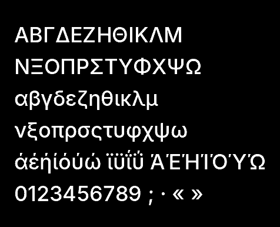

# CMF Watch 3 Pro Greek font patch

The CMF Watch 3 Pro can't display Greek. Its only text font has Latin, Cyrillic, Chinese, Japanese and Korean glyphs but nothing for Greek, so Greek notifications show up as empty boxes.

This repo patches the Greek glyphs into the official firmware and flashes it to the watch over Bluetooth from a computer, without going through the Nothing X app. I've been running it on my own watch (firmware 1.0.1.77) and Greek notifications display fine.



The image above is rendered from the patched font itself (`tools/render_preview.py`), so it's exactly what the watch draws.

> [!WARNING]
> This is an unofficial project and isn't affiliated with or endorsed by Nothing Technology Ltd. or CMF. The product names are only used to say what it works with. Flashing modified firmware may void your warranty, and a mistake can leave the watch in its upgrade/recovery mode. The steps to recover from that are below, but there are no guarantees. Use it at your own risk.
>
> No firmware is distributed here. The scripts download the official image from Nothing's servers and patch it locally.

## Requirements

- A CMF Watch 3 Pro (board `JX402_08`) and its charger. Other CMF and Nothing watches run different firmware and aren't supported.
- A computer with Bluetooth LE, Python 3.9+ and Node.js 18+. The scripts download about 100 MB (firmware, font, `lv_font_conv`).
- Your phone, only to pair the watch with Nothing X again afterwards. While flashing, the watch must not be connected to the phone.

| Platform | Status |
|---|---|
| macOS, Apple Silicon | Tested (macOS 26.3, Python 3.9.6, Node 18). The terminal app needs Bluetooth permission in System Settings > Privacy & Security > Bluetooth. |
| macOS, Intel | Should work, not tested. |
| Linux (BlueZ) | Not tested. `bleak` supports it. The address is a MAC (`AA:BB:...`) rather than the UUID macOS uses, and you may have to pair/trust the watch with `bluetoothctl` first. |
| Windows 10/11 | Not tested. `bleak` supports it. Use `venv\Scripts\python` instead of `./venv/bin/python`. |
| Android, iOS | Can't flash from a phone. Gadgetbridge supports the older CMF Watch Pro but not this watch's firmware upload. |

Once flashed, the watch works with either an iPhone or an Android phone as before. Building the image (`greekify.py build`) doesn't need Bluetooth and runs anywhere Python and Node do.

## Quick start

```bash
python3 -m venv venv
./venv/bin/pip install -r requirements.txt
./venv/bin/python tools/greekify.py check   # watch version vs. latest official release
./venv/bin/python tools/greekify.py         # download, build, confirm, flash, verify
```

`greekify.py` looks up the latest Watch 3 Pro release in the [Nothing Archive](https://github.com/spike0en/nothing_archive) update list (model `D399`) and downloads it from Nothing's CDN. It fetches Inter and `lv_font_conv` into `cache/`, builds the patched image and stops if the font version check fails. If everything looks right it asks before flashing. After the upload it reconnects to make sure the watch didn't end up in upgrade mode.

The computer connects to the watch directly over Bluetooth. The phone isn't connected to the computer at all, it only has to let go of the watch, because the watch accepts one connection at a time:

1. On the phone, forget the watch in the Bluetooth settings (and unpair it in Nothing X if it's listed there), then close Nothing X. Turning off Bluetooth on the phone also works.
2. Put the watch on its charger next to the computer.
3. Run `greekify.py`. On the first run it pairs the computer with the watch. Accept the prompt on the watch or the computer if one appears.
4. The upload takes about 30 minutes, then the watch installs the update and reboots by itself.
5. Pair the watch with Nothing X on the phone again.

`greekify.py build` stops before the Bluetooth part. `--file` and `--url` let you supply the official image yourself.

## How it works

1. The official update is a single file (Actions "AOTA" format) with a few compressed parts: the main app, image resources and one font partition.
2. The font partition holds `sans36.font`, an LVGL bitmap font. It covers Latin, Cyrillic, CJK and Hangul, but not Greek.
3. The stock glyphs turned out to be Inter v4.0 Medium at 36 px. Re-rendering the Latin letters with it gives identical bytes. The Greek block (U+0370-03FF, 105 glyphs) is rendered with the same font and settings and appended to `sans36.font`.
4. The font partition has a fixed size, so the Hangul syllables are dropped to make room. Everything else stays byte for byte the same.
5. The font is repacked and every checksum in the image is recomputed. See [docs/firmware-format.md](docs/firmware-format.md#checksums-how-they-were-worked-out) for how the checksum rules were worked out.
6. Nothing X refuses modified images, so `cmf_flash.py` talks to the watch over BLE directly, using the protocol from Gadgetbridge's CMF Watch Pro support. The watch pulls the file and installs it like a normal update.

The full story, including the approaches that didn't work, is in [docs/process.md](docs/process.md).

## Never change the partition version

Don't change any `<version>` value in `ota.xml`. The app has a hard-coded table of the resource versions it expects (on 1.0.1.77 the font must be 29). At boot, `ver_chk` compares them, and on a mismatch the watch goes into upgrade mode. That's what happened on my first attempt, when I bumped the font version to 30. The build script leaves the version alone and checks it against the table.

## Recovery

If the watch boots to a QR code with "Please connect to the app to upgrade again", it's in upgrade mode. Bluetooth still works: `cmf_test.py` connects and reports the version as `0.0.1.77`. Flash the official image (or a fixed one) with `cmf_flash.py`. In this mode the upload is much slower, about 3.5 hours for a full image.

## Manual steps

```bash
# tools
python3 -m venv venv && ./venv/bin/pip install -r requirements.txt
npm install --prefix lvconv lv_font_conv@1.5.3
curl -LO https://github.com/rsms/inter/releases/download/v4.0/Inter-4.0.zip
unzip -j Inter-4.0.zip 'extras/ttf/Inter-Medium.ttf' -d fonts/

# official 1.0.1.77 image (check it against firmware/SHA256SUMS)
curl -L -o firmware/ORIGINAL_JX402_08_ATS3089C_V1.0.1.77.bin \
  https://dmen2t88o28qi.cloudfront.net/ota/1779242269230JX402_08_ATS3089C_V1.0.1.77_GPS_V6_20260418.bin

# build (sha256 of the result: 763357046b88553d32cf492e9d6f8882161b96fe80720022108641caf47cf3d9)
./venv/bin/python tools/build_greek_firmware.py \
  --firmware firmware/ORIGINAL_JX402_08_ATS3089C_V1.0.1.77.bin \
  --ttf fonts/Inter-Medium.ttf \
  --lv-font-conv lvconv/node_modules/.bin/lv_font_conv \
  --out firmware/CMF_Watch3Pro_1.0.1.77_greek.bin

# flash
./venv/bin/python tools/cmf_scan.py                # find the watch's address
./venv/bin/python tools/cmf_test.py  <ADDRESS>     # read-only: pairs and reads the version
./venv/bin/python tools/cmf_flash.py <ADDRESS> firmware/CMF_Watch3Pro_1.0.1.77_greek.bin
```

The first connection pairs with the watch and stores the key in `tools/authkey.hex`. Accept the pairing prompt if one appears. The key file is git-ignored and readable only by you. Anyone with it can talk to the watch, so don't share it.

## After an official update

An official update replaces the font partition, so Greek is gone again (the watch itself keeps working). Install the update through Nothing X, then run `greekify.py` as in the quick start. It downloads the new release, patches it and flashes it.

`greekify.py --allow-version-change` would install the update and the Greek patch in one go, since the official update file is exactly what gets patched. I haven't tried it yet. See [docs/updating.md](docs/updating.md) for details and the manual route.

## Layout

```
tools/
  greekify.py              fetch latest release, build, flash, verify
  build_greek_firmware.py  official image -> Greek image (reproducible)
  render_preview.py        render text with the watch font to a PNG
  cmf_scan.py              find the watch's BLE address
  cmf_test.py              pair and read the firmware version (read-only)
  cmf_flash.py             upload an image over BLE
  cmf_ble.py               BLE framing and crypto
  cmf_client.py            pairing, session, firmware upload
  unpack_aota.py           list/extract the parts of an image, check their CRCs
  sdfs.py                  list the files in an SDFS image
  lvfont.py, fontbuild.py  LVGL font reader/writer
  repack.py                SDFS, chunked LZMA and AOTA builders
docs/
  process.md               how this was done, dead ends included
  firmware-format.md       AOTA, chunked LZMA, SDFS and LVGL font formats
  ble-protocol.md          pairing, session crypto, firmware upload
  updating.md              re-applying the patch after an official update
```

`firmware/`, `cache/`, `venv/` and the pairing key are git-ignored.

## License and credits

AGPL-3.0, see [LICENSE](LICENSE).

- The BLE protocol code (`cmf_ble.py`, `cmf_client.py`) is ported from [Gadgetbridge](https://codeberg.org/Freeyourgadget/Gadgetbridge)'s `cmfwatchpro` support, which is AGPL-3.0. That's why the whole repo uses the same license.
- The Greek glyphs are rendered from [Inter](https://rsms.me/inter/) by Rasmus Andersson (SIL Open Font License 1.1). The font isn't included, the scripts download it.
- Please don't open issues or PRs with firmware images or patched `.bin` files.
